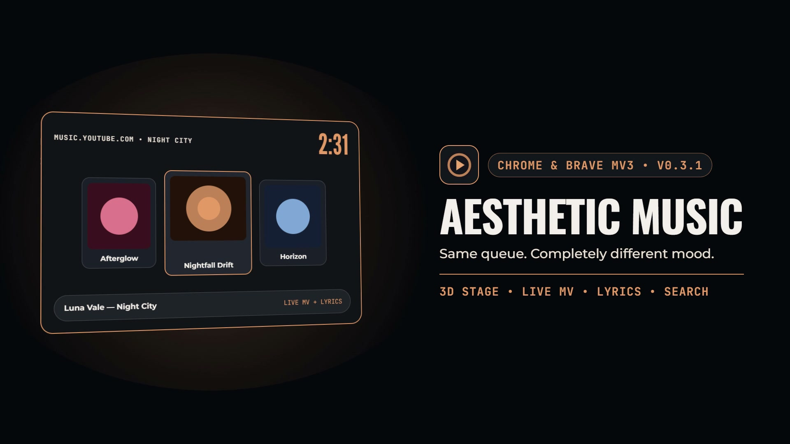
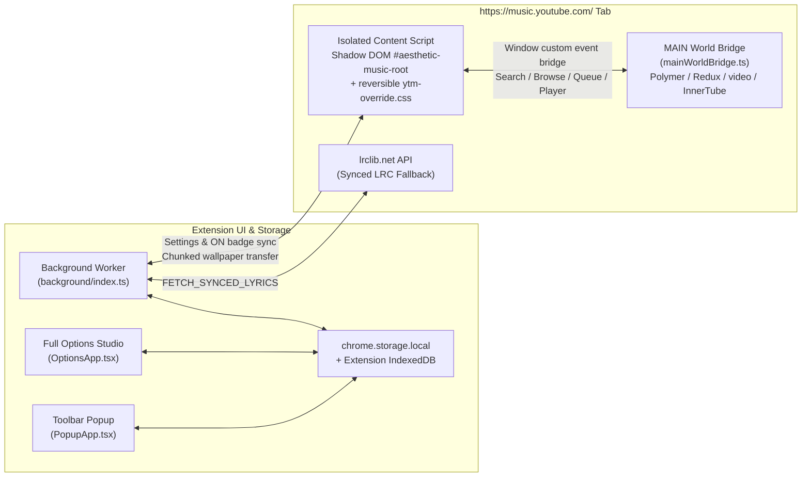

<div align="center">
  
  <h1>Aesthetic Music</h1>
  <p>
    <strong>Turns a YouTube Music browser tab into a spatial glassmorphic desktop player for Chrome and Brave.</strong>
  </p>

  <p>
    
    
    
    
    
  </p>

  <p>
    <a href="#features">Features</a> •
    <a href="#themes--customization">Themes & Customization</a> •
    <a href="#architecture">Architecture</a> •
    <a href="#installation">Installation</a> •
    <a href="#development--testing">Development</a> •
    <a href="./CHANGELOG.md">Changelog</a>
  </p>
</div>

<p align="center">
  
</p>

> Aesthetic Music layers an isolated Shadow DOM interface over `https://music.youtube.com/` while preserving your active queue, native `<video>` stream, likes, and playback state. Toggle **Aesthetic Mode OFF** from the toolbar at any time to restore the standard YouTube Music page cleanly.

---

## Features

<table>
  <tr>
    <td width="50%" valign="top">
      <h3>3D Album Stage & Queue Dock</h3>
      <ul>
        <li><strong>5-Card 3D Carousel:</strong> Perspective-angled coverflow deck with synced pagination dots and short-queue handling when fewer than 5 tracks are loaded.</li>
        <li><strong>3D-Angled Queue Sidebar:</strong> Live <em>Continue Playing</em> queue with direct track jumping, <strong>Play Next</strong>, <strong>Remove</strong>, manual refresh, and collapsible played history.</li>
        <li><strong>Floating Glass Player:</strong> Switchable <code>bottom-center</code>, <code>bottom-wide</code>, and <code>compact-dock</code> layouts with seek scrubbers, volume/mute, shuffle, repeat, and like sync.</li>
        <li><strong>Laptop Ergonomics (<code>v0.3.1</code>):</strong> Sized quick-action pills (<code>44px</code>), transport targets, widened settings popover (<code>400px</code>), and padded pointer hit areas on the seek bar.</li>
      </ul>
    </td>
    <td width="50%" valign="top">
      <h3>Dynamic Video & Ambient Backgrounds</h3>
      <ul>
        <li><strong>Auto Mode:</strong> Promotes native YouTube Music <code>&lt;video class="html5-main-video"&gt;</code> full-screen on music videos; falls back smoothly to dual-buffer blurred artwork on songs.</li>
        <li><strong>Video / Ambient / Custom / Off:</strong> Lock to video, stay on ambient album glow with canvas palette extraction, or drop to minimal obsidian.</li>
        <li><strong>Local Custom Wallpapers:</strong> Upload <code>JPG</code>, <code>PNG</code>, <code>WebP</code>, <code>GIF</code>, <code>MP4</code>, or <code>WebM</code> files up to <code>150 MB</code> stored locally in IndexedDB.</li>
        <li><strong>Backdrop Studio Controls:</strong> Live sliders for blur (<code>0–100 px</code>), brightness, darkness overlay, accent glow, motion speed, vignette, and film grain.</li>
      </ul>
    </td>
  </tr>
  <tr>
    <td width="50%" valign="top">
      <h3>Inline Search & Details Modal</h3>
      <ul>
        <li><strong>Categorized Search Overlay:</strong> Filter across <code>All</code>, <code>Artists</code>, <code>Songs</code>, <code>Videos</code>, <code>Albums</code>, and <code>Playlists</code> with square Top Results cards and circular Artist chips.</li>
        <li><strong>Split Entity Details Panel:</strong> Inspect Artists (<em>Top Songs</em>), Albums, and Playlists inside Aesthetic Mode with real <strong>Play</strong>, <strong>Shuffle</strong>, <strong>Play Next</strong>, and <strong>Add to Queue</strong> actions.</li>
        <li><strong>Preserved Navigation & Isolation:</strong> Press <code>Esc</code> or close details to return to your preserved search query; keyboard shielding stops YTM hotkeys from firing while typing.</li>
      </ul>
    </td>
    <td width="50%" valign="top">
      <h3>Synced & Static Lyrics Stage</h3>
      <ul>
        <li><strong>Dual Lyrics Pipeline:</strong> Reads native YouTube Music lyrics first and fetches millisecond-timed <code>.lrc</code> / plain lyrics from <code>lrclib.net</code> with an LRU cache.</li>
        <li><strong>Three Display Layouts:</strong> Switch between <code>Focus</code>, <code>Compact</code>, and <code>Full</code> modes with click-to-seek on timed lines and fallback switching via <strong>Other lyrics</strong>.</li>
        <li><strong>Eye Visibility Toggle:</strong> Switch cleanly between <strong>Album + Lyrics</strong> and centered <strong>Lyrics-Only</strong> mode (or toggle Zen clean view on the main stage).</li>
        <li><strong>Tab Power & GPU Guards:</strong> Suspends animation loops, clock tickers, and custom video playback while the tab is hidden; optional Low-GPU mode disables heavy glass blur.</li>
      </ul>
    </td>
  </tr>
</table>

---

## Themes & Customization

Customize everything live from the 3-tab **In-App Studio Popover** (`Presets` · `Clock & UI` · `Wallpaper`), the toolbar **Popup**, or the full **Options** page:

| Preset | Mood & Palette | Default Accent | Typography |
| :--- | :--- | :---: | :--- |
| **Night City** | Slate midnight glass & warm copper | `#C28356` | `Antonio` + `Inter` (`modern`) |
| **Minimal Dark** | Obsidian frost & crisp silver contrast | `#E4E4E7` | `Antonio` + `Inter` (`modern`) |
| **Cozy Room** | Espresso walnut glass & candlelit amber | `#DDA15E` | `Playfair Display` (`editorial`) |
| **Custom Studio** | Custom wallpaper + 6 accent swatches / custom hex | User hex | `modern`, `editorial`, or `mono` |

Additional controls persisted in `chrome.storage.local`:
- **Clock:** Toggle visibility, 12h/24h format, scale (`75%–140%`), and clock accent color.
- **Layout:** Toggle Carousel, Queue Sidebar, and Search Bar; adjust panel transparency (`0–100%`), player glass opacity (`20–95%`), border radius (`12–32 px`), thumbnail size, and startup behavior (`autoActivateOnYTM`, `rememberSettings`).

---

## Architecture

Aesthetic Music separates page-world YouTube Music internals from the Shadow DOM UI so upgrades and toggles remain non-destructive:



### Permissions & Privacy

Declared in [`public/manifest.json`](./public/manifest.json):
- `storage` — Persist user settings cleanly across sessions without external servers.
- `activeTab` — Communicate Aesthetic Mode state and track status with the open YouTube Music tab.
- `https://music.youtube.com/*` — Mount the Shadow DOM interface, bridge native playback/queue controls, and promote native `<video>`.
- `https://lrclib.net/*` — Fetch optional time-synced `.lrc` lyrics fallback in the background worker when native timed lyrics are absent.

No analytics, tracking scripts, or third-party user accounts are used. Uploaded wallpapers stay strictly inside your browser's local `IndexedDB`.

---

## Installation

### Prerequisites
- **Node.js** `18+` and **npm**
- **Google Chrome** or **Brave Browser**

### Build from Source

```bash
git clone https://github.com/Mrcod3xx/YT-AestheticMusic.git
cd YT-AestheticMusic
npm install
npm run build
```

This runs version synchronization verification, TypeScript type-checking (`tsc --noEmit`), and all three Vite builds into `dist/`:
- `dist/manifest.json`
- `dist/popup/index.html` & `dist/options/index.html`
- `dist/background.js`, `dist/content.js`, `dist/mainWorldBridge.js`

### Load Unpacked in Chrome or Brave

1. Open `chrome://extensions/` (Chrome) or `brave://extensions/` (Brave).
2. Enable **Developer mode** (top-right toggle).
3. Click **Load unpacked** and select the generated `dist/` folder inside your cloned repository.
4. Open [`https://music.youtube.com/`](https://music.youtube.com/), start playing music, and click the **Aesthetic Music** icon in your browser toolbar to toggle **Aesthetic Mode ON / OFF**.

---

## Development & Testing

| Script | Purpose |
| :--- | :--- |
| `npm run build` | Verifies version sync, runs `tsc --noEmit`, and bundles popup, options, background, content script, and MAIN-world bridge into `dist/`. |
| `npm test` | Runs the Vitest unit suite (`vitest run`). |
| `npm run test:watch` | Runs Vitest in interactive watch mode. |
| `npm run check:version` | Verifies [`package.json`](./package.json), [`public/manifest.json`](./public/manifest.json), and [`src/shared/version.ts`](./src/shared/version.ts) match. |
| `npm run version:bump -- patch` | Bumps `patch`, `minor`, `major`, or an explicit `x.y.z` version across all three version manifests. |

Unit tests in `tests/` cover:
- [`tests/lyricsParser.test.ts`](./tests/lyricsParser.test.ts) — Track/artist cleanup, LRC timestamp parsing, and LRCLIB candidate scoring.
- [`tests/themeTokens.test.ts`](./tests/themeTokens.test.ts) — Preset token resolution, hex parsing fallback, and font stack mapping.
- [`tests/innertubeParsers.test.ts`](./tests/innertubeParsers.test.ts) — YouTube Music search category classification, `Top Results` & `Artists` extraction, and Artist/Album/Playlist browse parsing.
- [`tests/versionSync.test.ts`](./tests/versionSync.test.ts) — Version synchronization across manifest, package, and runtime source plus changelog entries.
- [`tests/runtimeAndAdapters.test.ts`](./tests/runtimeAndAdapters.test.ts) — Shadow DOM keyboard-shield detection, MV3 runtime safety guards, and artwork resolution scaling.

<details>
<summary><strong>Project Structure & Roadmap (All Phases Complete through v0.3.1)</strong></summary>

```text
├── public/
│   ├── manifest.json              # Extension MV3 manifest
│   └── icons/                     # Extension toolbar & browser icons (16..128px)
├── docs/
│   └── banner.jpg                 # README hero showcase banner
├── scripts/
│   └── bump-version.mjs           # Version check & bump script
├── src/
│   ├── background/index.ts        # Badge sync, LRCLIB fallback, wallpaper chunks
│   ├── bridge/mainWorldBridge.ts  # MAIN-world YTM player, queue & browse bridge
│   ├── content/                   # Isolated Shadow DOM React UI & YTM adapters
│   │   ├── adapters/              # Bridge, player, queue, search, lyrics, video
│   │   └── components/            # Carousel, Clock, Sidebar, Search, Lyrics, Settings
│   ├── options/                   # Standalone full settings studio page
│   ├── popup/                     # Browser action quick-toggle popup
│   └── shared/                    # Types, defaults, themes, storage & parsers
└── tests/                         # Vitest unit suites
```

- [x] **Phase 0–1:** MV3 foundation, Shadow DOM mount, reversible YTM override CSS, popup toggle, storage sync
- [x] **Phase 2–3:** 5-card 3D carousel, queue sidebar, floating glass player, real Polymer/InnerTube integration
- [x] **Phase 4–5:** Live `<video>` backdrop engine, ambient dual-buffer crossfade, native + LRCLIB timed lyrics, Lyrics-Only eye toggle
- [x] **Phase 6–7:** Theme presets, custom local wallpapers in IndexedDB, visibility/GPU optimizations, Vitest suite & laptop hit-target pass (`v0.3.1`)

</details>
